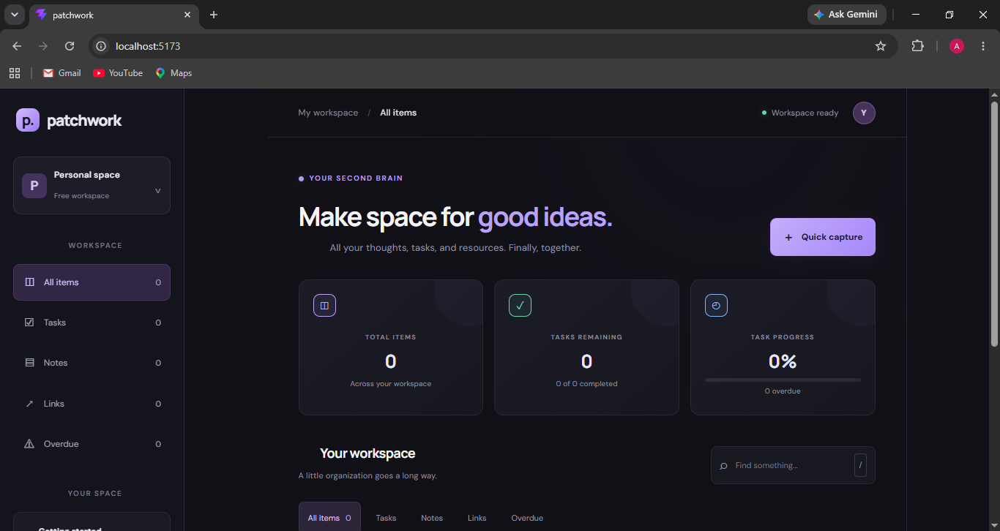
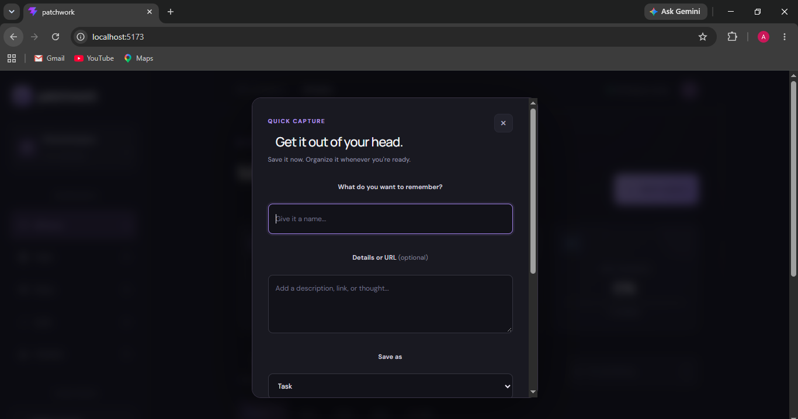
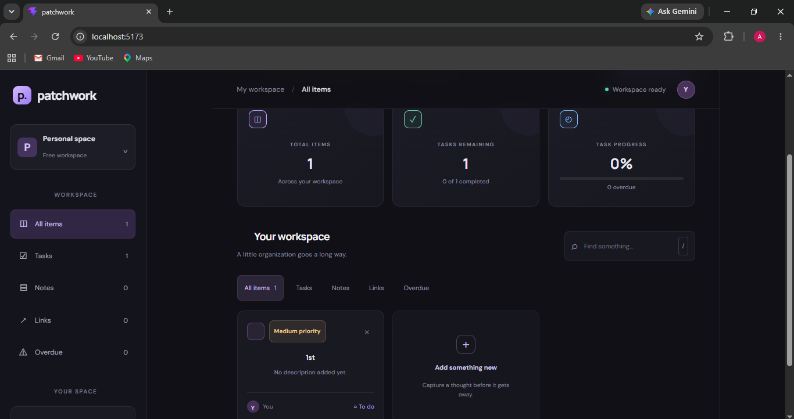

# 🧩 PATCHWORK

### Your second brain, thoughtfully organized.

PATCHWORK is a personal productivity workspace that brings tasks, notes, and useful links together in one place.

Ideas, deadlines, and useful resources often end up scattered across different applications. PATCHWORK provides one focused workspace to capture information, organize tasks, and keep track of progress.

---

##  Screenshots

### Dashboard



### Quick Capture



### Task Management



---

##  Features

###  Task Management
- Create tasks with titles and descriptions.
- Mark tasks as complete or incomplete.
- Assign Low, Medium, or High priority.
- Set deadlines for tasks.
- Identify overdue tasks.
- Automatically prioritize unfinished tasks.

###  Notes
- Capture ideas, reminders, and useful information.
- Keep notes alongside tasks and resources.

###  Link Management
- Save useful website links.
- Open saved links directly from your workspace.
- Validate URLs when creating links.

###  Quick Capture
- Create tasks, notes, and links through one interface.
- Add descriptions to your items.
- Set task priorities and deadlines while creating tasks.

###  Search and Filtering
- Search items by title or description.
- Filter items by category.
- View overdue tasks separately.

###  Progress Tracking
- View total workspace items.
- Track remaining and completed tasks.
- Monitor task completion percentage.
- See how many tasks are overdue.

###  Local Storage
- Save workspace items in browser local storage.
- Keep saved items after refreshing the page.
- Start with an empty workspace when no saved data exists.

---

##  Built With

- React
- TypeScript
- Vite
- CSS
- Browser Local Storage

---

## Getting Started

### Prerequisites

Install Node.js and npm before starting.

### Installation

Clone the repository:

```bash
git clone https://github.com/zealot-adi/patchwork.git
```

Navigate into the project directory:

```bash
cd patchwork
```

Install the dependencies:

```bash
npm install
```

Start the development server:

```bash
npm run dev
```

Open the local URL displayed in your terminal, usually:

```text
http://localhost:5173/
```

---

##  How to Use

1. Open PATCHWORK in your browser.
2. Click **Quick capture** to create an item.
3. Choose Task, Note, or Link.
4. Enter a title and optional description.
5. For tasks, choose a priority and optionally set a deadline.
6. Save your item.
7. Search or filter your workspace to find items.
8. Mark tasks complete when finished.
9. Monitor your progress on the dashboard.

---

##  The Problem

Everyday tasks, ideas, and useful links can become difficult to manage when spread across multiple applications.

This fragmentation makes it harder to find information, remember deadlines, and understand what needs attention.

PATCHWORK addresses this problem by bringing everyday productivity items into one workspace, with quick capture, search, task priorities, and deadlines.

---

##  Design Philosophy

PATCHWORK is designed around four principles:

- **Simplicity:** Capture information without unnecessary steps.
- **Clarity:** Keep priorities and deadlines visible.
- **Organization:** Bring tasks, notes, and links together.
- **Focus:** Present useful information in a clean dashboard.

---

##  Privacy and Data Storage

PATCHWORK currently stores workspace items in browser local storage.

This means:

- Items remain available after refreshing the page in the same browser.
- Data is not automatically synchronized between devices.
- Clearing browser site data may remove saved items.
- The current version does not provide account-based cloud synchronization.

Avoid storing sensitive personal information in the application.

---

##  Future Improvements

Potential future improvements include:

- Editing existing tasks, notes, and links.
- Keyboard shortcuts.
- Improved mobile and tablet layouts.
- Better accessibility.
- Importing and exporting workspace data.
- Optional cloud synchronization.

---

##  Development

PATCHWORK is an independent project built to explore frontend development, interface design, and practical productivity tools.

The project is developed with React and TypeScript, using Vite for local development.

---

**Made for your mind. 🧩** 